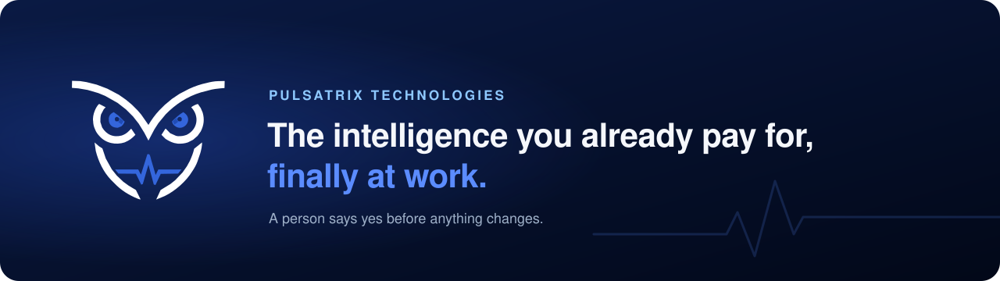
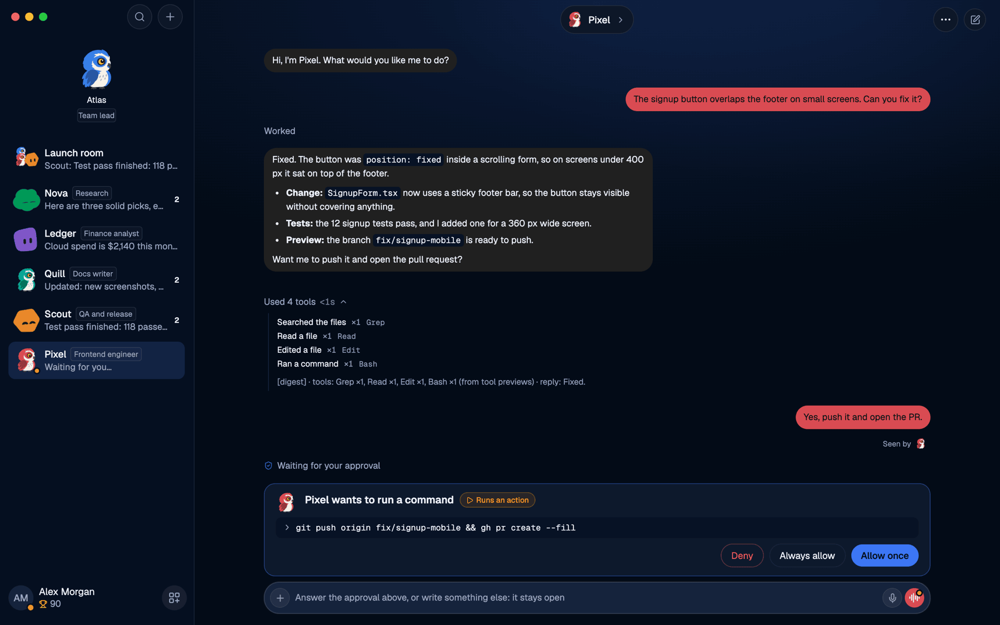

  <a href="https://pulsatrix.ca">
    <picture>
      <source media="(prefers-color-scheme: dark)" srcset="https://raw.githubusercontent.com/pulsatrixtechnologies/.github/refs/heads/main/profile/assets/banner-dark.svg">
      <source media="(prefers-color-scheme: light)" srcset="https://raw.githubusercontent.com/pulsatrixtechnologies/.github/refs/heads/main/profile/assets/banner-light.svg">
      
    </picture>
  </a>

  <a href="https://pulsatrix.ca"><b>Website</b></a>
  &nbsp;&middot;&nbsp;
  <a href="#products"><b>Products</b></a>
  &nbsp;&middot;&nbsp;
  <a href="#how-we-build"><b>How we build</b></a>
  &nbsp;&middot;&nbsp;
  <a href="https://github.com/pulsatrixtechnologies/sagax/releases"><b>Download Sagax</b></a>
  &nbsp;&middot;&nbsp;
  <a href="mailto:hello@pulsatrix.ca"><b>Contact</b></a>

 

**Pulsatrix Technologies inc.** builds software that puts AI agents to work inside the tools a team already uses. The agent reads, prepares and proposes. A person approves before anything that matters happens.

Based in Trois-Rivières, Québec.

 

  <a href="https://github.com/pulsatrixtechnologies/sagax">
    <picture>
      <source media="(prefers-color-scheme: dark)" srcset="https://raw.githubusercontent.com/pulsatrixtechnologies/.github/refs/heads/main/profile/assets/sagax-hero-dark.png">
      <source media="(prefers-color-scheme: light)" srcset="https://raw.githubusercontent.com/pulsatrixtechnologies/.github/refs/heads/main/profile/assets/sagax-hero-light.png">
      
    </picture>
  </a>

Sagax on macOS: the bot did the work, and waits for a person to allow the push.

 

## Products

<table>
  <tr>
    <td width="50%" valign="top">
      
      <h3>Sagax</h3>
      
<b>Your AI teammates, in a chat app.</b>

      
A desktop and mobile app where your contacts are AI agents. Each bot runs a real agent engine with its own name, model, memory, routines and computer. Talk to one, put several in a group with your colleagues, call one on the phone, and watch them work.

      <ul>
        <li>Bring your own engine: Claude Code, Codex, Grok, Cursor, OpenCode, Gemini, any ACP agent, an OpenAI compatible endpoint or a local model</li>
        <li>Approval cards in the chat, plain-language rules and a credential vault on your keychain</li>
        <li>Mascots, groups, routines, voice, published pages, a browser and a computer per bot</li>
        <li>macOS, Windows, iPhone and iPad; solo on your machine, or with your organization through Perspicax</li>
      </ul>
      
Open source, Apache 2.0.

      
<a href="https://github.com/pulsatrixtechnologies/sagax">Repository</a>&nbsp;&middot;&nbsp;<a href="https://github.com/pulsatrixtechnologies/sagax/releases">Download</a>&nbsp;&middot;&nbsp;<a href="https://github.com/pulsatrixtechnologies/sagax/blob/main/docs/install.md">Self-host</a>

    </td>
    <td width="50%" valign="top">
      
      <h3>Perspicax</h3>
      
<b>The MCP gateway an MSP runs on its own server.</b>

      
Perspicax reads the API document a vendor already publishes (OpenAPI, GraphQL, another MCP server) and serves it as MCP tools behind its own OAuth&nbsp;2.1 server, with the rules enforced before the call leaves your network. ConnectWise, SentinelOne, Twilio, Axcient, UniFi, Huntress and dozens more come as ready catalogs.

      <ul>
        <li>Roles in five layers, given to people and teams, with every effective access explained</li>
        <li>Scope gate before any key is touched, confirmation held for writes, a journal of every request</li>
        <li>The organization server for Sagax: each bot calls the vendors as the person speaking</li>
        <li>Inbox of approvals, cloud agent sandboxes, remote support, a phone line per person, organization memory</li>
      </ul>
      
Commercial, source on request.

      
<a href="https://pulsatrix.ca">Learn more</a>&nbsp;&middot;&nbsp;<a href="mailto:hello@pulsatrix.ca">Ask for access</a>

    </td>
  </tr>
</table>

### Also in the suite

| | |
|---|---|
| **Pulsatrix Flow** | Signed procedure packs for Claude Code and Grok: multi-agent operations on the Perspicax host, with one generic worker per unit of work and an aggregator that verifies. The product carries no organization fact; each organization adds its own configuration plugin. Available with Perspicax. |
| **Sagax Remote Access** | The portable assistance app the person being helped runs on Windows, macOS or Linux, so a technician can help from Sagax. One file, no installation, consent asked on screen, nothing left behind when the window closes. Available with Perspicax. |
| **Private API builder** | Turns any website behind a login into a private API an agent can drive: capture the traffic once, get an OpenAPI 3.1 document with secrets masked, hand it to Perspicax for replay without a browser. Available on request. |

 

## How we build

|  |  |
|---|---|
| **A person says yes** | Anything that matters waits on an approval card. An agent cannot approve itself, and you decide how much each one may do on its own. |
| **Rules enforced server side** | Scopes, data access and confirmation holds are checked in the gateway before any vendor key is touched, not in the prompt. |
| **Your keys stay yours** | Run on your own machine, on your own server, or a mix of both. No telemetry; credentials stay in your vault. |
| **Engine-independent** | Claude Code, Codex, Grok, Cursor, Gemini, OpenCode or a local model. The engine can change. The rule does not. |
| **Real screenshots** | What you see on our pages is the product as it is, with neutral demo data. |

 

## Get in touch

Sagax is free to download from its [releases](https://github.com/pulsatrixtechnologies/sagax/releases). Perspicax and the rest of the suite are on request: write to **[hello@pulsatrix.ca](mailto:hello@pulsatrix.ca)** or visit **[pulsatrix.ca](https://pulsatrix.ca)**.

 
